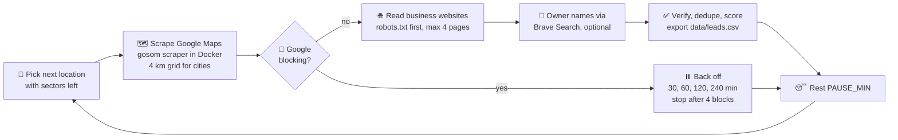

<div align="center">

# 🛰️ Lead Watch

**Google Maps → verified, deduplicated business leads, 24/7.**

Pick sectors and locations, press **Start**, and Lead Watch scrapes Google Maps, reads each business's own website for contacts and owner names, verifies emails, and exports clean leads to `data/leads.csv`.


[Quick start](#-quick-start) · [How it works](#-how-it-works) · [Dashboard](#-the-dashboard) · [Export](#-what-you-get) · [Settings](#%EF%B8%8F-settings) · [24/7 hosting](#%EF%B8%8F-run-it-247-for-free) · [Staying safe](#%EF%B8%8F-staying-safe)

</div>

---

## 🚀 Quick start

You need Python 3 and Docker (running).

```powershell
git clone https://github.com/Sahilsonii/Lead-Watch.git; cd Lead-Watch
python -m venv .venv; .venv\Scripts\pip install -r requirements.txt
.venv\Scripts\python pipeline\dashboard.py
```

Open **http://localhost:8765**, pick sectors and locations, press **Save targets**, then **Start**.

<details>
<summary>🐧 On macOS / Linux</summary>

```bash
git clone https://github.com/Sahilsonii/Lead-Watch.git && cd Lead-Watch
python3 -m venv .venv && .venv/bin/pip install -r requirements.txt
.venv/bin/python pipeline/dashboard.py
```

</details>

---

## 🔄 How it works

Every cycle runs this loop until you press **Stop**:



<details>
<summary><b>Step by step</b></summary>

1. **Pick** the next location that still has sectors to search. Single cities always come first, then any [whole country](#-whole-country-search), place by place.
2. **Scrape** it with [gosom/google-maps-scraper](https://github.com/gosom/google-maps-scraper) in Docker. A location up to 2,500 km² (a city or district) is searched as a **grid** of 4 km cells, which finds far more than the ~120 places Google returns for one search. Bigger areas (states, whole countries) fall back to one plain search per sector.
3. **Check** whether Google is blocking the IP, and back off if so ([details](#-when-google-blocks)).
4. **Read** up to 300 business websites politely: robots.txt first, one page at a time per site, 1–2 s apart, at most 4 pages each (home, contact, about, team).
5. **Look up** missing owner names through Brave Search, if you turned it on ([LinkedIn names](#-linkedin-names-optional)).
6. **Export** every lead with a verified email or a mobile number, best leads first.

</details>

### ♻️ Dedupe is always on

| Level | Rule |
|---|---|
| **Searches** | A sector × location runs once, ever. Grid and plain searches are tracked separately. |
| **Places** | Stored by Google place id, so a business found by two searches is saved once. |
| **Websites** | Each site is read once, ever. Leads that share a website (a chain) share one read. |
| **Contacts** | In the export, a repeated email or phone (chains, duplicate listings) appears once. |

---

## 🖥️ The dashboard

One local page at `http://localhost:8765` with:

- **What to scrape:** pick a country (and cities, if you like), then choose sectors from the dropdown that appears, or type your own. Press **Save targets**. The dropdown's list lives in `sectors.txt`.

### 🌍 Whole-country search

Pick a country, leave cities empty and press **Add**: the chip reads **All of India**. Lead Watch then works through the whole country by itself, one place per cycle, **smallest areas first**:

| Order | Level | What it is | How it is searched |
|---|---|---|---|
| 1 | Villages | 1,000–15,000 people | grid over a 4 km box around the village |
| 2 | Towns | 15,000–100,000 people | grid over an 8 km box around the town |
| 3 | Cities | 100,000+ people | grid over the city's real outline (OpenStreetMap) |
| 4 | States | each state or region | plain search per sector |
| 5 | Country | the whole country | plain search per sector |

Inside each level the least populated place goes first. Cities you add yourself always run before any country's places, and a place you already listed is searched once. Picking a country shows the size of the job (for India: 7,213 places, so at least 151 days at one place per 30-minute cycle), and the run panel shows where the sweep is ("Villages · 12 of 3,433 · Uttar Pradesh").

Place data comes from [GeoNames](https://www.geonames.org/) (CC BY 4.0), downloaded once (about 10 MB) into `data/geo/` the first time you pick a country.
- **Start / Stop:** the choice survives a reboot. If the loop was running, it resumes by itself.
- **Run & health:** the current location, grid cell progress, Google's status, websites read and LinkedIn usage.
- **Light / dark** toggle that remembers your choice.

> [!NOTE]
> The dashboard listens on localhost only, because the Start/Stop buttons must not be public.

---

## 📦 What you get

`data/leads.csv` with 20 columns:

> Business Name · Owner Name · Owner Source · Address/Location · Postcode · City · Region · Business Sector · Category · Phone · Email · WhatsApp · Website · Total Google Reviews · Rating · Short Brief · Date Added · Authenticity Verdict · Social Links · Sources

<details>
<summary><b>What each tricky column means</b></summary>

- **Owner Name** is best effort. **Owner Source** says where it came from, best first: Website structured data, Website team page, Business name ("Dr. …"), Website email link (a named mailto link), LinkedIn search result, Email address (guess), or Not found. Company-looking names ("SMILE DENTAL LTD") are never used as owners.
- **Phone** and **WhatsApp** use each country's standard grouping with the country code (`+971 4 566 2262`, `+44 20 7946 0958`, `+1 416-555-0199`), however Google wrote them. A number that can't be parsed is left as it was.
- **WhatsApp** is the mobile number. It is likely on WhatsApp but not checked.
- **Website** is empty when the Maps "website" is really a Facebook, Instagram or directory page; that link moves to **Social Links**, with the Instagram, Facebook, LinkedIn and other profiles found on the site.
- **Sources** says which source found the lead (`google_maps` for now).
- **Postcode / City** are empty where Google has none (for example the UAE). City then falls back to the searched location.

</details>

<details>
<summary><b>How the Authenticity Verdict is scored</b></summary>

The verdict is the share of these signals that apply to the lead:

| Signal | Applies to |
|---|---|
| Owner-claimed listing | Google leads |
| 10+ reviews | Google leads |
| Has a website | all |
| Verified email | all |
| Valid phone | all |
| Site matches listing (shows the listing's phone or name) | only when the site was read |

| Share of signals | Verdict |
|---|---|
| ≥ ⅔ | ✅ Verified |
| ≥ ⅓ | 🟡 Likely genuine |
| less | 🔴 Weak |
| business closed | ⚫ Closed |

The signals found are listed next to the verdict.

</details>

---

## ⚙️ Settings

Set these as environment variables before starting the dashboard.

<details>
<summary><b>All settings</b></summary>

| Variable | Default | What it does |
|---|---|---|
| `CONCURRENCY` | 2 | Parallel browser tabs in the scraper |
| `DEPTH` | 10 | How far each search scrolls (~120 places) |
| `GRID_CELL_KM` | 4 | Grid cell size; smaller finds more but takes longer |
| `PAUSE_MIN` | 30 | Rest between cycles (doubles while Google blocks) |
| `ENRICH_PER_CYCLE` | 300 | Websites read per cycle |
| `LINKEDIN_PER_CYCLE` | 30 | Brave searches per cycle |
| `BRAVE_API_KEY` | (none) | Turns on LinkedIn name lookups |
| `BRAVE_MONTHLY_CAP` | 1000 | Hard cap on Brave searches per month |
| `SMTP_CHECK` | off | `1` adds an SMTP mailbox check |

`blocked_domains.txt` lists website domains that are never read (government and health-service sites by default: `.gov`, `.gov.uk`, `.nhs.uk`, …). Add one suffix per line.

</details>

### 🚧 When Google blocks

<details>
<summary><b>How blocking is detected and handled</b></summary>

A run counts as blocked when most searches fail, when Google shows its "unusual traffic" page, or when it finds nothing without every search finishing cleanly. (Searches that all finish cleanly and find nothing just mean an empty area.)

| Blocks in a row | Pause before next cycle |
|---|---|
| 0 (clean run) | 30 min |
| 1 | 60 min |
| 2 | 120 min |
| 3 | 240 min |
| 4 | **Loop stops itself** |

At four blocks the dashboard says "Google is blocking this IP. Stopped to protect it." Wait a day or move to another IP, then press Start. An interrupted run (Stop, crash, reboot, block) resumes where it left off rather than starting over. Website reading and LinkedIn lookups keep going while Google blocks, because they use other hosts.

If anything else fails (for example `leads.csv` is open in Excel), the loop writes the error to `data/runner.log`, shows it on the dashboard, and tries again after the pause.

</details>

### 🔎 LinkedIn names (optional)

<details>
<summary><b>How it works and how to turn it on</b></summary>

Lead Watch never opens LinkedIn. For leads with no better owner name once their website has been read, it searches Brave for `"Business Name" City site:linkedin.com` and reads the result titles ("Sara Ali - Founder - Smile Clinic | LinkedIn"). A profile counts only if the result mentions the business. Each lead is searched once.

To turn it on:

- [ ] Create a Brave Search API key at https://api-dashboard.search.brave.com/ (the free monthly credit covers about 1,000 searches).
- [ ] In the Brave dashboard, set a **spending limit**, so you can never be charged beyond the credit.
- [ ] Set the key in your environment, never in a file: `$env:BRAVE_API_KEY = "..."`, then start the dashboard.

Lead Watch also stops at `BRAVE_MONTHLY_CAP`, on Brave's "limit reached" responses, and when Brave rejects the key.

</details>

> [!IMPORTANT]
> Owner names and profile links are personal data under GDPR and similar laws. Keep a lawful basis for holding them (usually legitimate interest, documented), tell people where you got their details when you first contact them, and delete them on request.

---

## ☁️ Run it 24/7 for free

<details>
<summary><b>Oracle Cloud Always Free (Ubuntu) with systemd</b></summary>

```bash
sudo apt update && sudo apt install -y docker.io python3-venv
sudo usermod -aG docker ubuntu && newgrp docker
# copy this folder to /home/ubuntu/lead-pipeline, then:
cd ~/lead-pipeline
python3 -m venv .venv && .venv/bin/pip install -r requirements.txt
sudo cp deploy/lead-pipeline.service /etc/systemd/system/
sudo systemctl enable --now lead-pipeline
```

To view the dashboard from your PC, use an SSH tunnel, then open http://localhost:8765:

```bash
ssh -L 8765:localhost:8765 ubuntu@<vm-ip>
```

If the loop was running before a reboot, it resumes by itself.

</details>

---

## 🛡️ Staying safe

- **Google:** keep `CONCURRENCY` at 1–2 and the pause in place; the back-off handles blocks. Never solve or bypass CAPTCHAs.
- **Websites:** Lead Watch identifies itself (`LeadWatch/0.2 … respects robots.txt`), obeys robots.txt and Crawl-delay, and skips any site that shows a bot check. It never tries to pass one. A website that redirects to Facebook, LinkedIn or a directory is not followed there; the link is kept under Social Links. A site asking for more than 30 s between pages gets its homepage read only.
- **Email:** most clouds block port 25, so SMTP checks usually fall back to `mx_ok` (the domain receives mail; the mailbox itself is not proven).

> [!WARNING]
> Scraping may breach Google's terms, and contacting leads is regulated (GDPR, PECR, CAN-SPAM, CASL). WhatsApp bans accounts that send unsolicited bulk messages. You are responsible for how you use this tool and the data it collects.

---

## 🧪 Tests

Each test is a plain Python script with asserts, no test runner needed.

```powershell
cd pipeline
foreach ($t in "process","grid","geo","dashboard","backoff","contacts","enrich","linkedin") { ..\.venv\Scripts\python "test_$t.py" }
```

<details>
<summary><b>Project layout</b></summary>

```text
pipeline/
  dashboard.py / .html   local dashboard, Start/Stop, the run loop
  grid.py                plans each run as a grid of map cells (or plain searches)
  geo.py                 every village, town, city and state of a country (GeoNames)
  backoff.py             block detection and pause doubling
  enrich.py              polite website reader (robots.txt, one request at a time)
  contacts.py            email, phone, owner name and social link extraction
  linkedin.py            optional owner names via Brave Search
  process.py             lead database: ingest, verify emails, dedupe, CSV export
  test_*.py              one assert-based test script per module
deploy/lead-pipeline.service   systemd unit for 24/7 hosting
niches.txt, cities.txt         default sectors and locations
blocked_domains.txt            domains that are never read
data/                          leads.db, leads.csv, runner.log, geo/ (git-ignored)
```

</details>

See [CHANGELOG.md](CHANGELOG.md) for what changed. Released under the [MIT License](LICENSE). Place data © [GeoNames](https://www.geonames.org/), CC BY 4.0.
